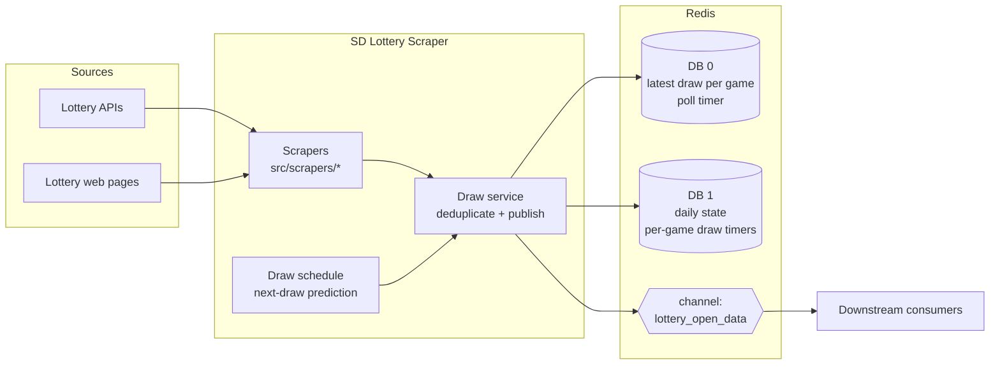
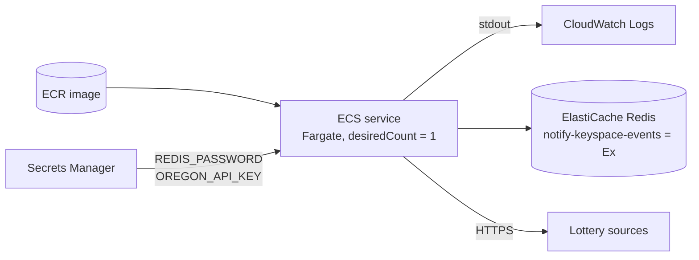

# SD Lottery Scraper: Real-Time Draw Ingestion Service

A Node.js background service that collects live keno and bingo draw results from six public lottery operators in four countries. It normalises them into one shared format and publishes each new draw over Redis Pub/Sub, so other services can react within seconds.

It also predicts when each game's next draw is due and announces it ahead of time. Consumers can show countdowns and open betting windows without polling every source themselves.

## Why it exists

Each lottery operator publishes results differently. Some use JSON APIs, some only have HTML pages, and they all differ in draw intervals, time zones, maintenance windows and daylight-saving rules. Downstream applications (dashboards, notification services, game front-ends) want one thing: *"a new draw happened, here are the numbers"*.

This service is the single integration point that hides that difference behind one event stream.

## Supported sources

| Code   | Operator / game                               | Region                  | Integration         | Draw interval |
|--------|-----------------------------------------------|-------------------------|---------------------|---------------|
| `jnd`  | BCLC Keno (PlayNow)                           | British Columbia, CA    | JSON API            | 3.5 min       |
| `jnc`  | WCLC Keno                                     | Western Canada          | HTML scraping       | 5 min         |
| `ddbj` | Taiwan Lottery Bingo Bingo                    | Taiwan                  | HTML scraping       | 5 min         |
| `au`   | Keno ACT                                      | Australia               | JSON API            | 160 s         |
| `elg`  | Oregon Lottery Keno                           | Oregon, US              | Authenticated API   | 4 min         |
| `slfk` | eKlub Keno (Tipos)                            | Slovakia                | HTML scraping       | 3 min         |

The table above is configured in `src/services/draw-schedule.service.js` (interval, daily close time, overnight pause, and DST handling).

## Architecture



### How it works

The service has no cron jobs or in-process timers. All scheduling is done with **Redis key expiry events** (`notify-keyspace-events Ex`), so the schedule is kept in Redis and is visible from outside the process.

1. **Polling loop (DB 0).** After each pass over all sources, the service sets the key `run_get_number` with a 5-second TTL. When that key expires, Redis sends an event and the next pass starts. Because a new pass only starts after the previous one finishes, passes never overlap.
2. **Ingestion.** Each scraper returns a normalised draw `{ peroids, time, number[] }`. The draw service compares it with the last stored draw (`game_list_<code>`) and drops anything that isn't newer, so repeated polling doesn't produce duplicate events.
3. **Publishing.** A new draw is published to the `lottery_open_data` channel and stored as both the latest draw and the current daily state.
4. **Next-draw prediction (DB 1).** The schedule service calculates when the next draw is due. It accounts for each game's interval, its daily close and overnight pause, and North American DST changes. It then sets a per-game key that expires exactly at that time. When the key expires, the service publishes an *upcoming draw* event (`category`, `peroids`, `time`, with no numbers yet). Consumers can use this to open the next round on time, even before the source has published results.

### Event format

```jsonc
// New result
{ "category": "jnd", "peroids": 3012345, "time": "2026-11-07 14:03:30", "number": [3, 7, 11, /* … */ 78] }

// Upcoming draw (scheduled, numbers not yet known)
{ "category": "jnd", "peroids": 3012346, "time": "2026-11-07 14:07:00" }
```

## Project structure

```
src/
├── index.js                       Entry point: subscribes to expiry events, starts the loop
├── config/                        Environment-based configuration (Redis connections)
├── lib/
│   ├── http-client.js             HTTP/HTML fetching helpers and source URLs
│   └── redis.js                   Redis clients (state, Pub/Sub, keyspace subscriptions)
├── services/
│   ├── draw.service.js            Deduplication, persistence and event publishing
│   └── draw-schedule.service.js   Per-game draw intervals, closing hours, DST rules
└── scrapers/                      One adapter per lottery source
scripts/dev/                       Manual scripts for checking individual sources
```

Each scraper is an **adapter** that hides one source's quirks and returns the same draw shape. To add a source you add one file in `src/scrapers/`, one entry in the schedule config and one line in `src/index.js`. Nothing else changes.

## Tech stack

- **Node.js 22**
- **Redis 7** for state, Pub/Sub and keyspace-notification scheduling
- **request-promise / cheerio** for fetching JSON and parsing HTML
- **Day.js** (utc, timezone) for time-zone and DST-aware scheduling
- **Docker / Docker Compose** for local runs; **AWS ECS (Fargate) + ElastiCache** in production

## Getting started

### Prerequisites

- Docker and Docker Compose, **or** Node.js 22+ and a Redis 7 instance with keyspace notifications enabled.

### Configuration

```bash
cp .env.example .env
```

| Variable          | Description                                         | Default     |
|-------------------|-----------------------------------------------------|-------------|
| `REDIS_HOST`      | Redis hostname                                      | `127.0.0.1` |
| `REDIS_PORT`      | Redis port                                          | `6379`      |
| `REDIS_PASSWORD`  | Redis password (required by the Compose setup)      | n/a         |
| `OREGON_API_KEY`  | Subscription key for the Oregon Lottery API         | n/a         |
| `REDIS_TLS`       | `true` to connect over TLS (ElastiCache in-transit encryption) | `false` |

### Run with Docker Compose (recommended)

```bash
docker compose up --build
```

This starts Redis with keyspace notifications already enabled, plus the service. Redis is reachable from the host on `127.0.0.1:6390` (override with `REDIS_LOCAL_PORT`).

### Run locally with Node

```bash
npm ci
redis-cli config set notify-keyspace-events Ex   # required for the scheduling loop
npm start
```

### Watch the event stream

```bash
redis-cli -p 6390 -a "$REDIS_PASSWORD" subscribe lottery_open_data
```

## Deploying to AWS ECS

The container image runs `node src/index.js` as its only process. ECS handles restarts, log collection and rollouts, so no process manager (PM2, forever) runs inside the container.



### Checklist

| Concern | Setting | Why |
|---|---|---|
| **Single instance** | ECS service `desiredCount: 1`, no autoscaling; deployment `minimumHealthyPercent: 0`, `maximumPercent: 100` | Every task receives the same Redis expiry events. Two tasks running at once, even briefly during a rolling deploy, would both publish the same draws. |
| **Keyspace notifications** | ElastiCache custom parameter group with `notify-keyspace-events = Ex` | ElastiCache blocks `CONFIG SET`. Without this setting the polling loop never fires, and the service fails without any error. |
| **Graceful shutdown** | Handled in code. On `SIGTERM` the service closes all Redis connections and exits (5 s safety timeout), well inside ECS's default 30 s `stopTimeout`. | Deploys and task replacements stop cleanly, with no half-open Redis connections. |
| **Secrets** | Inject `REDIS_PASSWORD` and `OREGON_API_KEY` from Secrets Manager via the task definition's `secrets` field | Keeps credentials out of the image and out of plain-text environment variables. |
| **Logging** | `awslogs` log driver to a CloudWatch log group | Every draw and every error is logged to stdout with an ISO timestamp. |
| **Networking** | Private subnets with a NAT gateway (outbound HTTPS to sources); a security group allowing the task to reach ElastiCache on 6379 | The service has no inbound traffic and exposes no ports. |
| **Encryption** | ElastiCache with in-transit encryption + AUTH token; set `REDIS_TLS=true` | ElastiCache only allows AUTH over TLS. Draw data and credentials are encrypted in transit inside the VPC. |

The trade-off of `minimumHealthyPercent: 0` is a short gap during each deploy, roughly the length of a container start. The polling design covers this: when the new task starts, it picks up the latest draw from every source on its first pass.

## Design decisions

- **Redis expiry events instead of in-process timers.** The schedule survives as Redis state, can be inspected with `redis-cli`, and can't drift or pile up overlapping runs the way `setInterval` can when a source is slow.
- **Dedupe by draw number.** Draw numbers increase over time at every source, which makes them a natural idempotency key. Polling often is safe, and a draw is published only once.
- **Separate Redis databases** keep long-lived state and Pub/Sub (DB 0) apart from short-lived daily scheduling keys (DB 1), so their expiry subscriptions don't interfere.
- **The container runs one process, with no process manager inside it.** Restarts, health and logs belong to the orchestrator (ECS), not to a supervisor process that would hide crashes from it.
- **Errors are handled per run.** A failing source returns nothing for that pass and the loop continues. One unavailable operator never stops ingestion for the others.

## Roadmap

Planned improvements:

- Migrate to TypeScript, with a shared `Draw` type for all adapters.
- Upgrade to `redis` v4 (native promises) and replace the deprecated `request-promise` with `undici`/`fetch`.
- Add unit tests for `draw-schedule.service.js` (DST changes, closing hours) and contract tests for each adapter against recorded responses.
- Make draw deduplication atomic (Lua script or `SET … NX` per draw number) so the service can run more than one task.
- Replace the hard-coded DST date table with time-zone-aware calculation.
- Use structured logging (pino) and a health/metrics endpoint for monitoring.
- Remove the legacy Express history routes in the scrapers. They are registered but no HTTP server is started.

## Disclaimer

This project only reads publicly available draw results, for informational and engineering purposes. It does not place bets or handle money. Before running it against a source, check that operator's terms of use.
