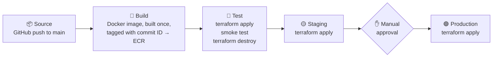
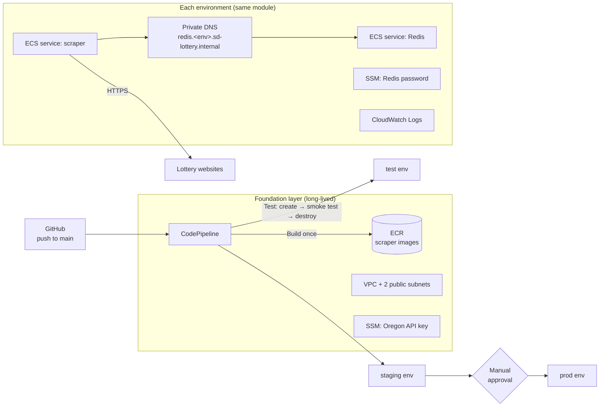

<div align="center">

# API Lottery Scraper
### My personal Terraform lab: building a CI/CD pipeline on AWS

<a href="#tech-stack"></a>


</div>

> [!IMPORTANT]
> **This is my personal lab, not a production system.**
> It's the third project in my DevOps portfolio, and I use it to practise **Terraform**, with the focus on
> building a **CI/CD pipeline on AWS**. I'm still in the practice phase, getting to know Terraform by
> building one layer at a time and learning from my mistakes along the way.
> Everything runs in my own AWS account. I create it for a demo and destroy it afterwards.
> I've listed the shortcuts I took, and what I'd do differently, [further down](#shortcuts-i-took-on-purpose).

## What this lab is for

I wanted to learn Terraform by building something real, not by copying a tutorial's "hello world" bucket. So I took an existing Node.js service (a scraper that collects live lottery draw results) and set myself this goal:

**Describe all of its AWS infrastructure in Terraform, and deploy every change automatically through an AWS CI/CD pipeline: test → staging → manual approval → production.**

The application is only the thing being deployed. The learning is in [`infra/`](infra/):

- **Terraform:** how to structure it in layers, where to keep state, how layers share information, and how to write one reusable module for several environments.
- **CI/CD on AWS:** how CodePipeline and CodeBuild run Terraform for you, how one image moves through every environment, and how a test environment can be created and destroyed automatically on every run.

## The pipeline (the focus of this lab)

Every `git push` to `main` runs this pipeline. All of it, including the pipeline itself, is defined in Terraform ([foundation/pipeline.tf](infra/foundation/pipeline.tf)).



| Stage | Runs on | What happens |
|---|---|---|
| **Source** | CodeConnections | Picks up the commit from GitHub. No access tokens stored in AWS |
| **Build** | CodeBuild (ARM) | Builds the image once and pushes it to ECR, tagged with the commit ID |
| **Test** | CodeBuild | Creates a fresh test environment, checks that draws are really being published, then **always** destroys it, pass or fail |
| **Staging** | CodeBuild | `terraform apply` with the same image tag |
| **Approval** | Manual | A person checks staging and clicks *Approve* |
| **Production** | CodeBuild | Same deploy script as staging, now with `ENVIRONMENT=prod` |

## Progress

| Stage | What I built | Status |
|---|---|---|
| 1. Containerise | Dockerfile + Docker Compose (app + Redis) running locally | ✅ Done |
| 2. Bootstrap | S3 bucket for Terraform remote state (versioned, encrypted, private) | ✅ Done |
| 3. Foundation | VPC, subnets, ECR image repo, GitHub connection, shared secret | ✅ Done |
| 4. Environment module | One reusable module: ECS cluster, Redis + scraper services, security groups, IAM, private DNS | ✅ Done |
| 5. Environments | `test`, `staging`, `prod` all built from that same module | ✅ Done |
| 6. CI/CD pipeline | CodePipeline: build → test (create, smoke test, destroy) → staging → manual approval → prod | ✅ Done |
| 7. Code quality in the pipeline | `terraform fmt`/`validate`, tflint, checkov security scan | ⏳ Next |
| 8. Closer to production | Private subnets + NAT, monitoring/alarms, less copy-paste between environments | 📋 Planned |

## Architecture



### Terraform layout

```
infra/
├── bootstrap/          State bucket. Created once, keeps its own state locally.
├── foundation/         Network, image repo, GitHub connection, pipeline. Long-lived.
├── modules/
│   └── environment/    Everything one environment needs, written once.
├── environments/
│   ├── test/           Calls the module with environment = "test"
│   ├── staging/        ...= "staging"
│   └── prod/           ...= "prod"
└── pipeline/           The scripts CodeBuild runs in each pipeline stage.
```

Why split it into layers? Each layer changes at a different speed and carries a different risk. The state bucket should never be destroyed. The network and pipeline barely change. Environments are created and destroyed often, and the test environment only exists for a few minutes during each pipeline run. With separate layers, each one has its own state file, so running `terraform destroy` on test can't touch anything else.

Step-by-step setup instructions are in [infra/README.md](infra/README.md).

## What I've learned so far

These are the Terraform concepts I've used in this project, with where to find each one:

| Concept | What it does | Where |
|---|---|---|
| **Remote state + locking** | State lives in S3, not on my laptop. `use_lockfile` stops two runs from changing it at once, without needing DynamoDB | [foundation/versions.tf](infra/foundation/versions.tf) |
| **The bootstrap problem** | The state bucket can't store the state of its own creation, so that one layer keeps its state locally | [bootstrap/main.tf](infra/bootstrap/main.tf) |
| **Modules** | Write the environment once, use it three times. Only the inputs differ | [modules/environment/](infra/modules/environment/) |
| **Sharing data between layers** | `terraform_remote_state` reads the foundation's outputs (VPC ID, subnets), so no IDs are copy-pasted | [environments/test/main.tf](infra/environments/test/main.tf) |
| **`for_each` and `dynamic` blocks** | Create one resource per item in a map or set, such as subnets per availability zone or CodeBuild projects | [network.tf](infra/foundation/network.tf), [pipeline.tf](infra/foundation/pipeline.tf) |
| **`lifecycle` rules** | `prevent_destroy` protects the state bucket. `ignore_changes` stops Terraform from overwriting a secret I set by hand | [bootstrap/main.tf](infra/bootstrap/main.tf), [foundation/secrets.tf](infra/foundation/secrets.tf) |
| **Input validation** | The module refuses any environment name other than test, staging or prod | [modules/environment/variables.tf](infra/modules/environment/variables.tf) |
| **`default_tags`** | Every resource is tagged with project, layer and environment automatically | every provider block |
| **Secrets** | Terraform generates the Redis password and stores it in SSM. ECS injects it at start-up, so it's never in code or the image. I also learned that **secrets end up in the state file**, which is why the state bucket is encrypted and private | [modules/environment/secrets.tf](infra/modules/environment/secrets.tf) |
| **Least-privilege IAM** | Each environment can read only its own password. The pipeline can manage only IAM roles that start with this project's name | [iam.tf](infra/modules/environment/iam.tf), [pipeline.tf](infra/foundation/pipeline.tf) |
| **Terraform in a pipeline** | Pinned Terraform version, `-auto-approve` behind a manual approval gate, and `finally:` to destroy the test environment even when tests fail | [infra/pipeline/](infra/pipeline/) |

Some CI/CD ideas I practised along the way:

- **Build once, promote.** The image is built one time, tagged with the commit ID, and that exact image moves through test → staging → prod. ECR tags are immutable, so a tag always points to the same image.
- **Throwaway test environment.** Every pipeline run creates a fresh test environment, checks that the scraper really publishes draws, and then destroys it. Pass or fail, nothing is left running.
- **Automatic rollback.** The ECS deployment circuit breaker rolls back to the previous version if a new one fails to start.

## Shortcuts I took on purpose

This is a demo on my own AWS account, so I chose cost and simplicity over production-grade setup in a few places. I know they're shortcuts, and here's what I would do instead:

| Shortcut | Why I did it | In production I would… |
|---|---|---|
| Public subnets, no NAT gateway | A NAT gateway costs ~$32/month. Security groups still block all inbound traffic | Run tasks in private subnets with a NAT gateway (or VPC endpoints) |
| test, staging and prod in one AWS account | Simpler for a demo | Give each environment its own account (AWS Organizations) |
| Redis as an ECS container, no persistence | To practise running containers. The scraper refills Redis within seconds | Use ElastiCache, or at least add persistence |
| CodeBuild uses `PowerUserAccess` | Terraform creates many kinds of resources; scoping every permission is a big job | Narrow it to the services the pipeline actually manages |
| `environments/*/main.tf` are near-copies | Easy to read: each environment is one obvious file | Remove the duplication with Terragrunt or a shared wrapper |
| No automated checks on the Terraform code yet | I focused on getting the pipeline working first | Add `fmt`, `validate`, tflint and checkov (next on my list) |

## The application

The thing being deployed is a Node.js service that collects live keno and bingo results from six public lottery operators in four countries (Canada, US, Taiwan, Australia, Slovakia). It turns every source into one shared format and publishes each new draw on a Redis Pub/Sub channel, so other services can react within seconds.

| Code | Source | Integration | Draw interval |
|---|---|---|---|
| `jnd` | BCLC Keno, British Columbia | JSON API | 3.5 min |
| `jnc` | WCLC Keno, Western Canada | HTML scraping | 5 min |
| `ddbj` | Taiwan Lottery Bingo Bingo | HTML scraping | 5 min |
| `au` | Keno ACT, Australia | JSON API | 160 s |
| `elg` | Oregon Lottery Keno | Authenticated API | 4 min |
| `slfk` | eKlub Keno (Tipos), Slovakia | HTML scraping | 3 min |

Some details of how it works, because they affected the infrastructure:

- **Scheduling runs on Redis key-expiry events**, not timers in the code. That's why Redis must start with `--notify-keyspace-events Ex`. Without it, the service silently does nothing.
- **Exactly one scraper may run at a time.** Two would publish every draw twice. That's why the ECS services use `desired_count = 1` and `deployment_minimum_healthy_percent = 0`: the old task stops before the new one starts.
- **No inbound traffic.** The service only makes outbound HTTPS calls, so it has no load balancer and no open ports.

Example event on the `lottery_open_data` channel:

```json
{ "category": "jnd", "peroids": 3012345, "time": "2026-11-07 14:03:30", "number": [3, 7, 11, 78] }
```

### Run it locally

```bash
cp .env.example .env          # fill in REDIS_PASSWORD (and OREGON_API_KEY if you have one)
docker compose up --build
redis-cli -p 6390 -a "$REDIS_PASSWORD" subscribe lottery_open_data   # watch draws arrive
```

## Tech stack

**Infrastructure as Code**


**CI/CD**


**AWS runtime**


**Application and containers**


## Disclaimer

This project only reads publicly available draw results, for learning and engineering purposes. It does not place bets or handle money.
